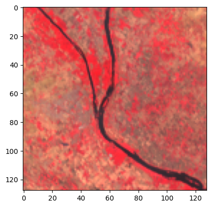
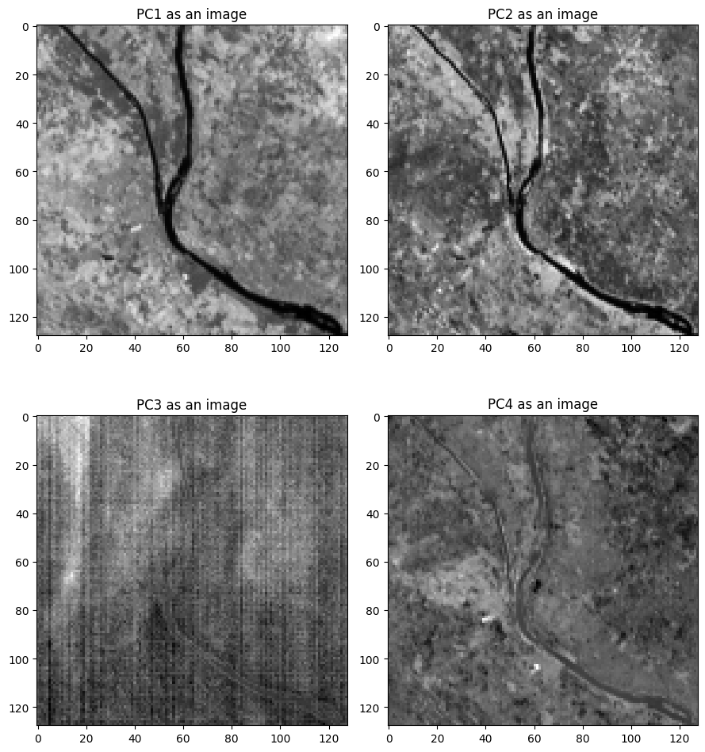
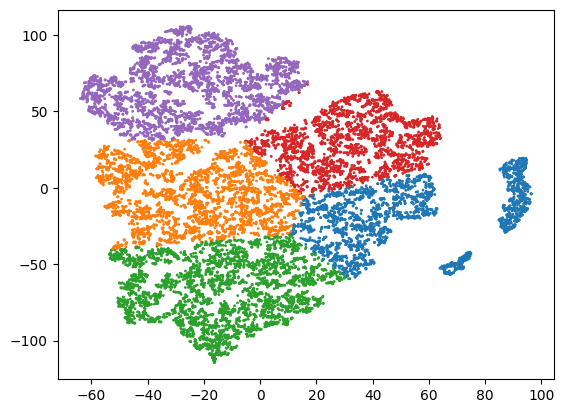
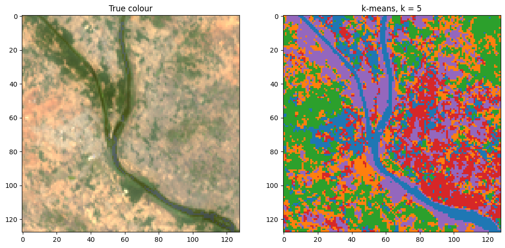
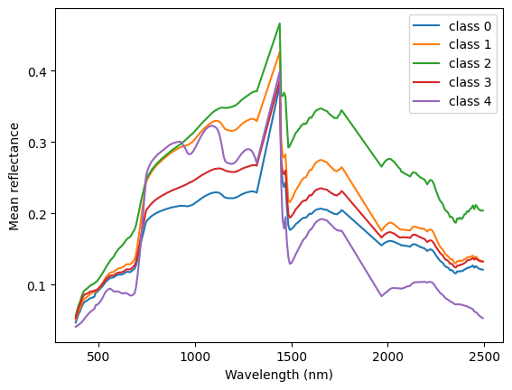

# Exploratory Analysis and Unsupervised Clustering of EMIT Hyperspectral Data

**Hyperspectral Remote Sensing | Spectral Analysis | PCA | t-SNE | K-means Clustering | Python**

## Project Overview

This project focuses on the exploratory analysis of hyperspectral satellite data acquired by NASA's Earth Surface Mineral Dust Source Investigation (EMIT) mission.

Using Python, the EMIT hyperspectral data were processed and analysed to investigate the spectral characteristics and spatial variations of pixels across a selected study area.

The analysis involves spectral signature visualisation, band-to-band correlation analysis, Principal Component Analysis (PCA), t-distributed Stochastic Neighbor Embedding (t-SNE), and K-means clustering.

The primary objective is to explore spectral similarities among pixels, reduce the dimensionality of the hyperspectral dataset, and investigate the resulting clusters through spatial visualisation and spectral analysis.

## Objectives

- Explore and understand NASA EMIT hyperspectral data.
- Examine pixel-wise spectral signatures across different wavelengths.
- Investigate correlations and redundancy among spectral bands.
- Apply PCA for dimensionality reduction and visualisation.
- Use t-SNE to explore similarities among pixels in a lower-dimensional feature space.
- Apply K-means clustering to group pixels based on their t-SNE representations.
- Analyse the spatial distribution and mean spectral characteristics of the resulting clusters.

  

## Dataset Information

The hyperspectral data used in this project were acquired by NASA's Earth Surface Mineral Dust Source Investigation (EMIT) mission.

- **Scene date:** 2 May 2024
- **Kaggle dataset:** EMIT_60233
- **Data product:** EMIT L2A Estimated Surface Reflectance and Uncertainty and Masks (60 m, V001)
- **Data format:** NetCDF

### Data Source

Green, R. (2022). *EMIT L2A Estimated Surface Reflectance and Uncertainty and Masks 60 m V001*. NASA EOSDIS LP DAAC.

[https://doi.org/10.5067/EMIT/EMITL2ARFL.001](https://doi.org/10.5067/EMIT/EMITL2ARFL.001)

### Accessing the Dataset

The dataset is available through Kaggle. No separate NASA Earthdata account is required to access the Kaggle copy.

To use the dataset in Kaggle:

1. Open the notebook editor.
2. Click **Add Input**.
3. Search for `EMIT_60233`.
4. Add the dataset to your notebook.

## Analysis Workflow

The following workflow summarises the major steps involved in the hyperspectral image analysis.

1. Loading and exploring the EMIT hyperspectral data.
2. Examining wavelength information and quality masks.
3. Selecting suitable spectral bands and extracting a study area.
4. Visualising true-colour and false-colour images.
5. Extracting and analysing pixel-wise spectral signatures.
6. Investigating relationships between spectral bands using scatter plots and correlation analysis.
7. Applying Principal Component Analysis (PCA) for dimensionality reduction.
8. Applying t-SNE to explore similarities among pixels in a two-dimensional feature space.
9. Performing K-means clustering on the t-SNE representation.
10. Visualising the spatial distribution of clusters and analysing their mean reflectance spectra.

## Methodology

### 1. Spectral Analysis

The hyperspectral data contain multiple spectral bands, with each band representing reflectance information at a particular wavelength.

Pixel-wise spectral signatures were extracted and visualised to examine the variation of reflectance across different wavelengths.

Random pixel spectra were also plotted to explore the spectral diversity within the selected study area.

### 2. Band Correlation Analysis

Scatter plots were used to investigate relationships between selected spectral bands.

A correlation matrix was also generated to examine the degree of correlation between different bands and identify potential spectral redundancy.

### 3. Principal Component Analysis (PCA)

Principal Component Analysis (PCA) was applied to reduce the dimensionality of the hyperspectral dataset.

PCA transforms the original correlated spectral bands into a smaller set of uncorrelated principal components that capture major variations in the data.

The explained variance and scree plot were examined to understand the contribution of individual principal components.

Spatial images of selected principal components were also visualised.

### 4. t-Distributed Stochastic Neighbor Embedding (t-SNE)

t-SNE was applied to the selected PCA features to represent the high-dimensional pixel data in a two-dimensional feature space.

Different perplexity values were explored to investigate their influence on the resulting embedding.

This representation helps visualise similarities among pixels in the reduced feature space.

### 5. K-means Clustering

K-means clustering was performed on the two-dimensional t-SNE representation to group pixels into six clusters (K = 5).

The resulting cluster labels were mapped back to their corresponding spatial positions to generate a spatial cluster map.

### 6. Mean Spectral Analysis of Clusters

The mean reflectance spectrum of each cluster was calculated using the original hyperspectral reflectance data.

The resulting mean spectra were compared to examine spectral differences among the six clusters.

## Technologies and Libraries

The project was developed using Python in a Kaggle Notebook environment.

### Programming Language
- Python

### Python Libraries
- **NumPy:** Numerical computations and multidimensional array manipulation.
- **Matplotlib:** Plotting and visualisation of spectral data and analysis results.
- **Xarray:** Loading and handling multidimensional hyperspectral datasets.
- **Plotly:** Creating interactive visualisations, scatter plots and spectral plots.
- **ipywidgets:** Interactive controls and widgets within the notebook.
- **anywidget:** Supporting interactive widget functionality.
- **Scikit-learn:** Applying machine learning and dimensionality reduction techniques.

### Development Environment
- Kaggle Notebooks
- Jupyter Notebook

## Results and Visualizations

This section presents the major outputs obtained from the exploratory analysis of the EMIT hyperspectral dataset.

### 1. True-Colour Image

The true-colour composite provides a visual representation of the selected EMIT study area using visible spectral bands.

### 2. Principal Component Analysis (PCA)

PCA was used to transform the original hyperspectral data into principal components. The explained variance and spatial distribution of selected components were examined.

The first four principal components (PC1, PC2, PC3 and PC4) are visualised below.

### 3. t-SNE Visualisation

The t-SNE embedding represents the selected PCA features in a two-dimensional space, allowing the distribution and similarities of pixels to be explored.

### 4. K-means Clustering (K = 5)

K-means clustering (K = 5) was performed on the two-dimensional t-SNE representation. The resulting cluster labels were mapped back to their spatial positions to generate a spatial cluster map.

The original true-colour image is shown alongside the K-means cluster map for comparison.

### 5. Mean Reflectance Spectra

Mean reflectance spectra were calculated for each of the five clusters using the original reflectance data. These spectra were compared to examine differences in their spectral characteristics.

